# 🎬 SHE: 4K Visual Music Film & Blender DoF Pipeline

Autonomous computer-vision, Blender 3D, and procedural VFX pipeline for the full-length ambient visual music film **"SHE"** (7:25 | 10,680 frames @ 24fps | 4K `3840×2160`) by **Sayan Bhattacharya** and **Atandra Chakraborty (Between The Notes)**.

---

## 🚀 One-Click Google Colab Render (Self-Healing)

* **Blender 3D + Optical DoF 4K Pipeline (Recommended):**
  **[Open `SHE_4K_Blender_DoF_Colab.ipynb` in Colab](https://colab.research.google.com/github/sayan-bhattacharya/aianimationautomate/blob/codex/grounded-mushroom-colab/SHE_4K_Blender_DoF_Colab.ipynb)**
  * Per-frame & per-chunk Google Drive checkpointing (resumes at the exact frame if Colab disconnects)
  * Built-in 5-frame T4 GPU benchmark (`720p` & `1080p`)
  * 3D undulating sand dunes, Cycles GPU + OpenImageDenoise, optical Depth of Field (`f/2.0`), and 4K Lanczos upscale with `She.wav`
* **OpenCV Hybrid 4K Master & Teaser Pipeline:**
  **[Open `SHE_4K_Master_And_Teaser_Colab.ipynb` in Colab](https://colab.research.google.com/github/sayan-bhattacharya/aianimationautomate/blob/codex/grounded-mushroom-colab/SHE_4K_Master_And_Teaser_Colab.ipynb)**

---

## 🎥 Blender 3D + Optical Depth-of-Field Previews

| Mushroom Scene (`1:01` — Sun Center) | Forest Scene (`3:21` — Sunrise Left) | Dinosaur Caravan (`4:22` — Sun High Right) |
| :---: | :---: | :---: |
| 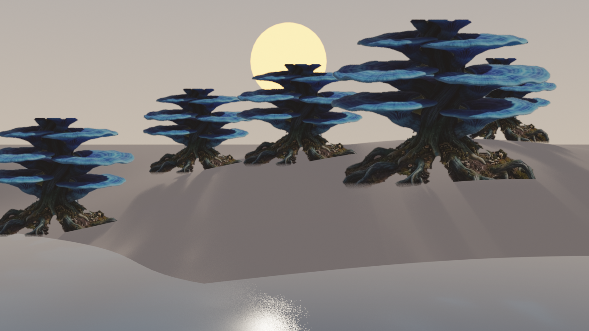 | 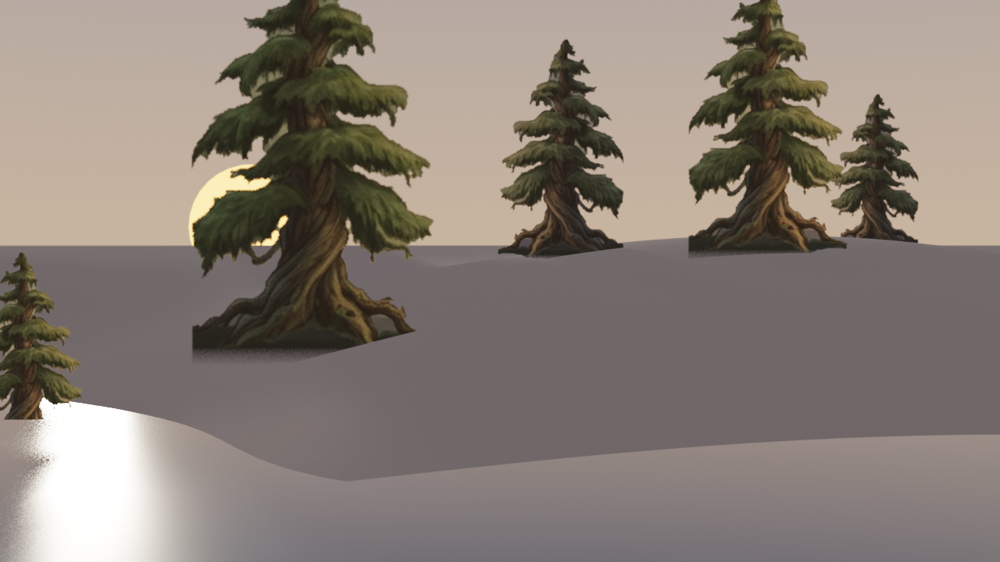 | 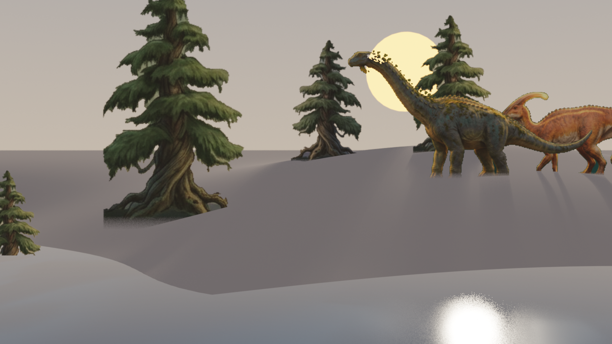 |

---

## 🧩 Cleaned 4K Assets (`assets/blender_clean/`)

All dinosaur sprites are exterior border flood-filled (zero interior `alpha=0` holes), and all botanical plates have dark studio floor pads stripped and feathered for seamless 3D dune grounding.

### Botanicals
| Pagoda Mushroom | Whorl Fir (Warm) | Whorl Fir (Deep) | Whorl Fir (Cool) |
| :---: | :---: | :---: | :---: |
| 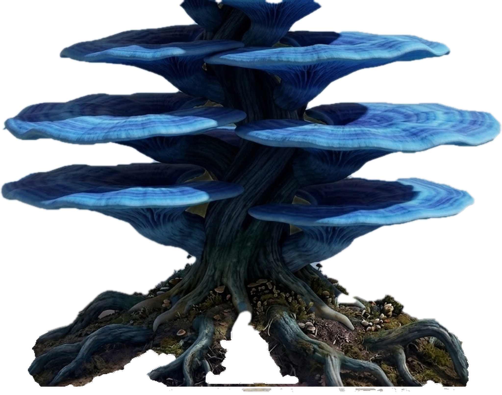 | 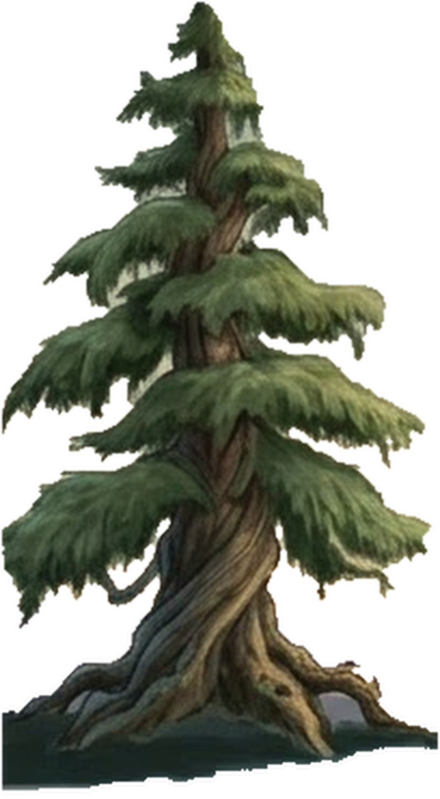 | 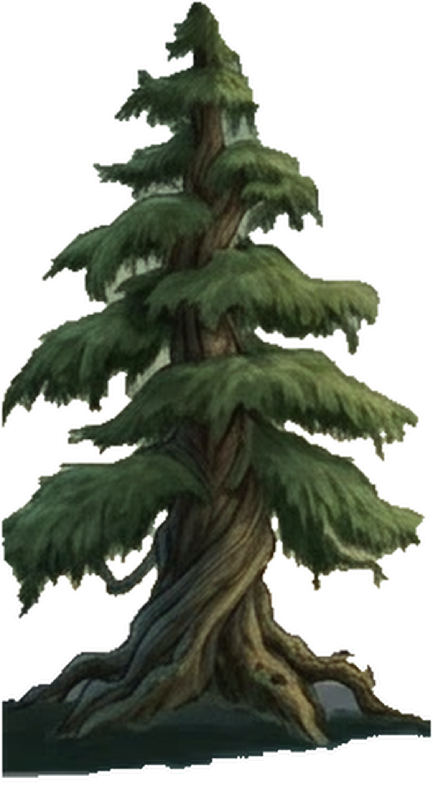 | 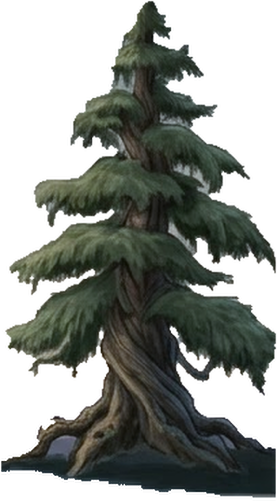 |

### Dinosaurs
| Sauropod | Hadrosaur | Ankylosaur | Raptor | Pterodactyl |
| :---: | :---: | :---: | :---: | :---: |
| 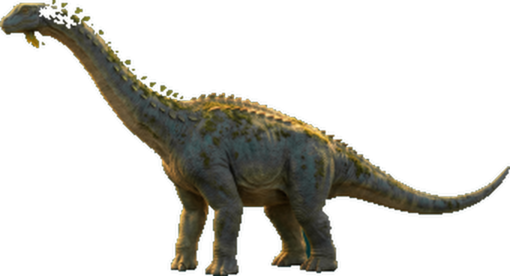 | 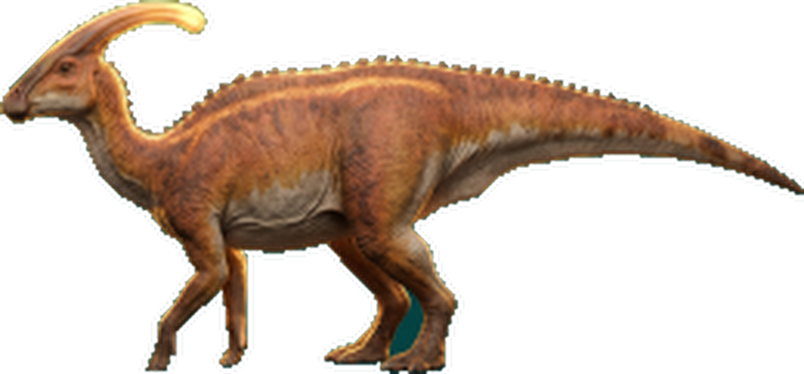 | 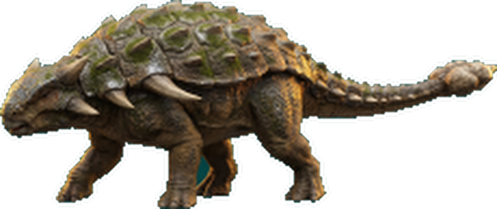 | 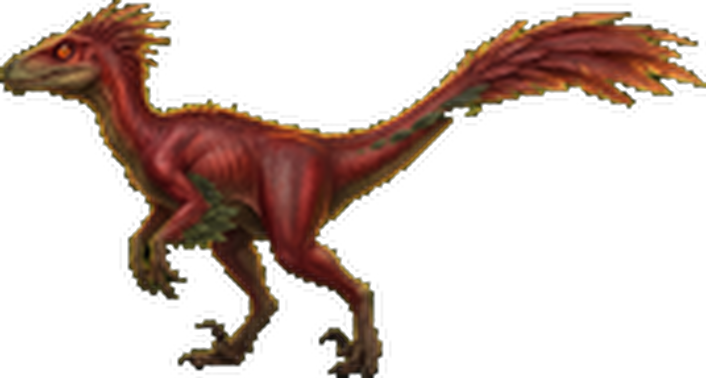 | 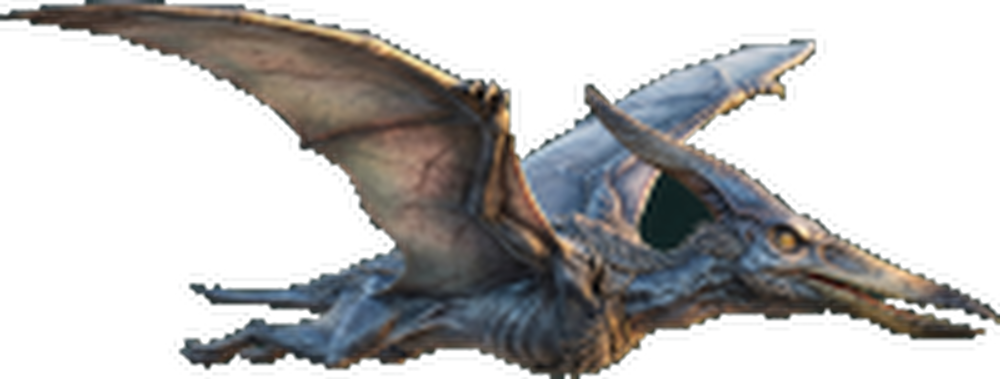 |

---

## 🛠️ Pipeline Highlights
1. **Self-Healing Drive Checkpointing**: Saves cleaned 4K assets, individual rendered frames, encoded 1080p/720p chunks, and pre-upscale masters directly to Google Drive.
2. **Botanical & Dinosaur Integrity**: Automated `clean_blender_assets.py` removes studio floor rectangles and interior alpha holes; `actors.py` removes floating foliage-nibble artifacts.
3. **True Perspective Telemetry Suite (2-Screen Buddha Redesign)**: Calibrated planar homography (`cv2.warpPerspective`) with chromatic aberration, CRT vignette, and phosphor bloom.
